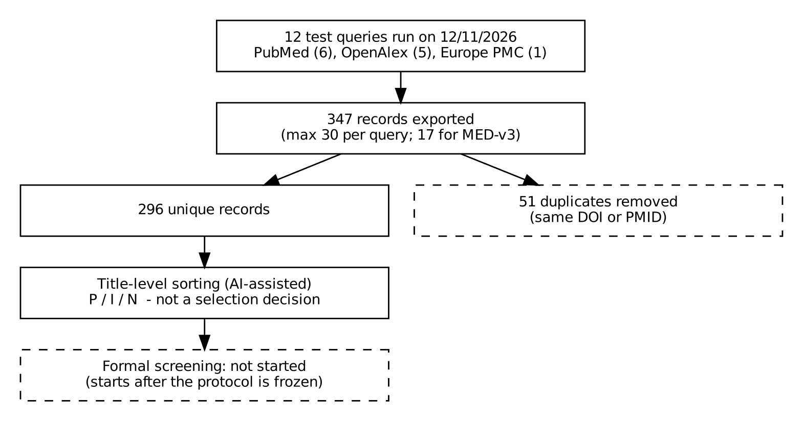
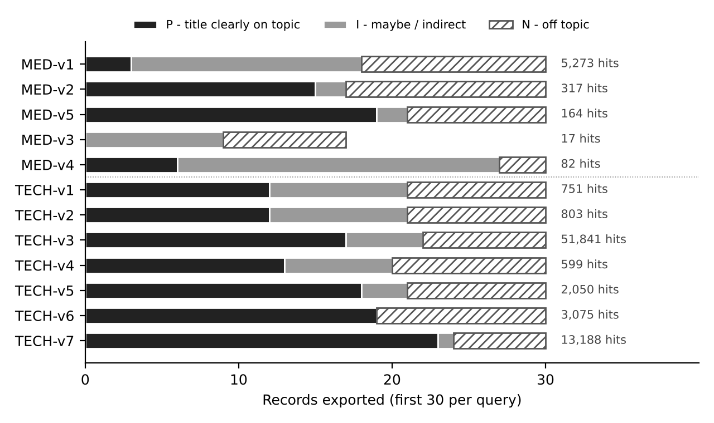

# FIBRO-RAG

Farah Hammami Research Master in Computer Science  
Week 1 Project scoping and literature review protocol 
## Project

I want to build an academic RAG assistant for uterine fibroids and test whether evidence-aware retrieval and claim verification improve the reliability of its answers. The assistant will use public medical evidence, cite its sources, and qualify or refuse answers when the evidence is insufficient. It is not a clinical tool.

The research idea is to compare four systems: M0 (LLM only), M1 (standard hybrid RAG), M2 (M1 plus evidence-aware re-ranking), and M3 (M2 plus claim verification and a selective answer decision). I will use ablations to isolate the effects of each component, and compare reliability at similar coverage. The corpus and evaluation are planned, not implemented yet.

## Week 1 deliverables

| File | Purpose |
| --- | --- |
| [Project scope](scoping/scoping_sheet.pdf) | Scope, users, three use cases, three design options and exclusions |
| [Review protocol](review/review_protocol.pdf) | Annex C, PCC question, criteria and methodology |
| [PRISMA in my own words](review/prisma_in_my_words.pdf) | One-page explanation |
| [Pilot search analysis](review/pilot_search_analysis.pdf) | Actual search results and query decisions |
| [Weekly report](weekly_reports/week_01.pdf) | Annex A, one page |
| [AI-use journal](ai_journal/ai_journal.pdf) | Annex B, significant uses, corrections and reflection |

## Pilot results

On 12 November 2026, I ran 12 queries locally on PubMed, Europe PMC and OpenAlex. All succeeded: 347 exported records, 296 unique and 51 duplicates removed. The original API files and hashes are saved in `review/pilot_run_local/`. Title labels are AI-assisted and exploratory; no formal screening or model evaluation has been performed.





## Repository structure

- `scoping/`, `review/`, `weekly_reports/`, `ai_journal/`: Week 1 reports and literature review evidence.
- `code/`: search, verification, unit tests and figure script.
- `knowledge_base/`: plan for the source corpus.
- `assistant/`: architecture for the planned assistant.
- `evaluation/`: experimental plan and eight draft FibroidQA scenarios.
- `figures/`: architecture and pilot figures.

## Reproduce the pilot

Use Python 3.10 or later. From the repository root:

```bash
python -m unittest discover -s code/bibliographic_search -p "test_*.py"
python code/bibliographic_search/verify_pilot.py
```

The offline verification checks the 28 original file hashes, exact query strings, counts, deduplication and title-label alignment. To run a new search (internet and possibly API credentials required), see [search instructions](code/bibliographic_search/README.md). New results may differ as databases update. Do not overwrite the archived run.

## Next steps

Screen titles and abstracts, check full texts and quality, and start a versioned corpus and gold benchmark. Use only public or authorized documents and synthetic questions. Without medical expert validation, the evaluation will measure faithfulness to the sources, not clinical accuracy.
