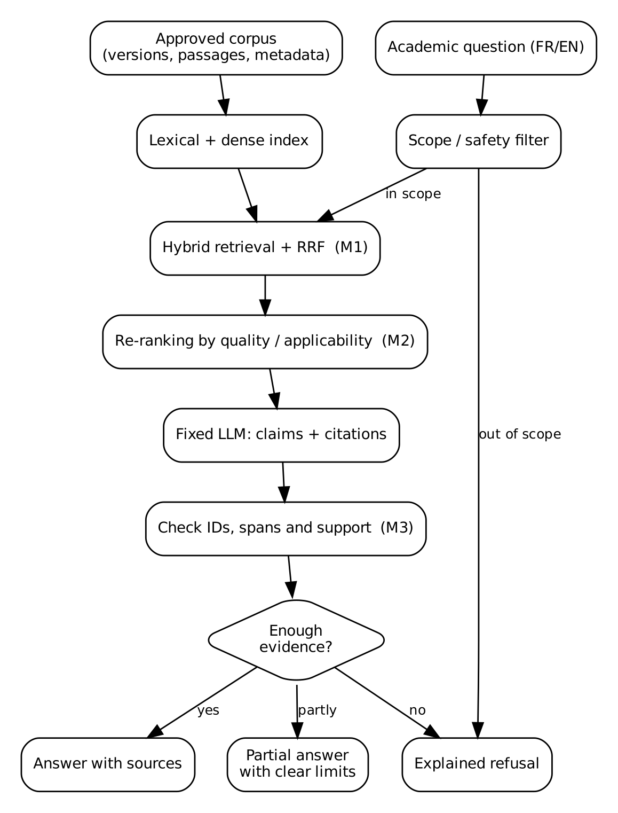

# Assistant architecture

The assistant is not implemented yet. This is the architecture I plan to test during the project.

## Before answering questions

I will select reliable sources, remove duplicates, extract the text and split it into passages. Each passage will have an ID and information about its source, date, evidence quality, population and clinical context.

Two retrieval methods will be used: BM25 for lexical matching and dense embeddings for semantic matching. I plan to combine their rankings using Reciprocal Rank Fusion (RRF).

## Answering a question

1. Check whether the question is within the project scope and safe to answer.
2. Normalize relevant French and English terms without changing units or negations.
3. Retrieve the top 20 candidate passages using hybrid retrieval (M1).
4. Re-rank them using relevance, applicability and documented evidence quality, then keep the top 5 (M2).
5. Generate an answer with individual claims and source IDs.
6. Check the citations and whether the passages support the claims (M3).
7. Decide whether to answer, give a qualified answer or abstain.

## Why these components?

A passage can be relevant to a question but not applicable to the population or outcome being discussed. For example, evidence about clinical pregnancy is not automatically evidence about live births. This is why I want to evaluate applicability separately from relevance.

A citation is also not enough on its own. The cited text needs to support the claim. If important evidence is missing, the system should explain the limitation instead of inventing an answer.

## First implementation

I plan to start with a small corpus of 20–40 allowed sources, RRF (initial k0 = 60), a simple re-ranking rule and a claim checker. The re-ranking rule will keep a minimum relevance requirement and use the original rank to break ties. Missing quality information will not automatically mean low quality.

A cross-encoder or more advanced retrieval methods can be tested later if time allows. I want to keep the first version simple enough to compare the components properly.

See the [experimental plan](../evaluation/experimental_plan.md) for baselines, metrics and ablations.

The system is for research and academic information, not personal medical advice. Text retrieved from documents is treated as evidence, not as instructions.
